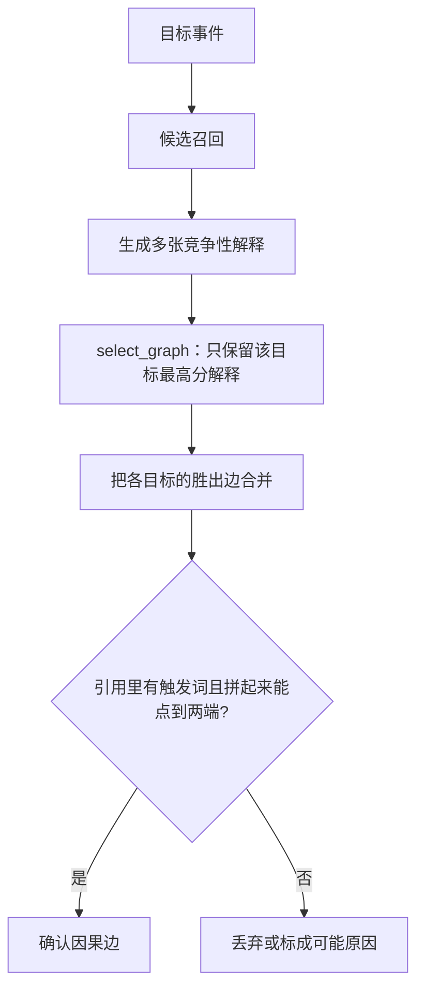
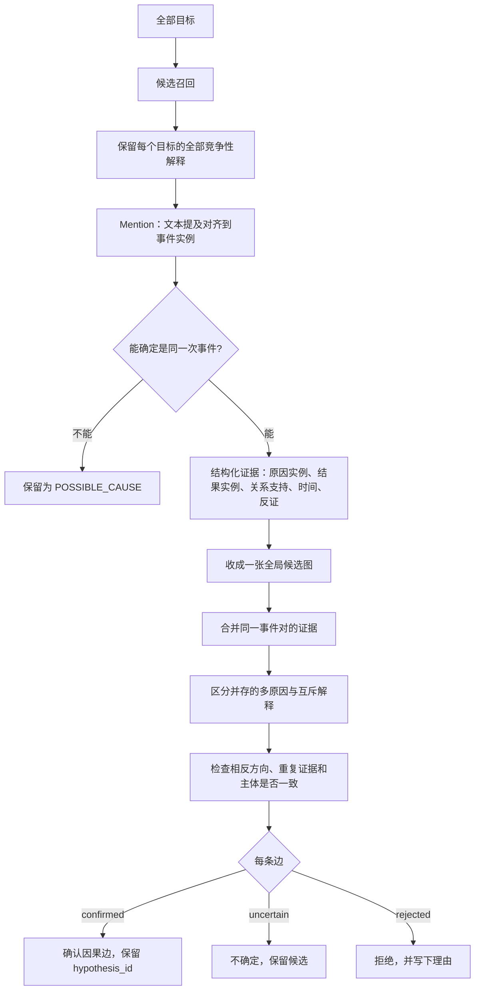

# 跨文档关系推断：修改前后

## 修改前

每个目标各自召回、各自生成解释，然后只留下该目标分数最高的一张图，再把这些图拼起来。证据是否成立，主要看引用里有没有因果触发词，以及把不同文档的句子接起来之后能不能同时点到两端。

## 修改后

先收下所有目标的全部解释和边。每条引用先对齐到具体事件实例，再按原因实例、结果实例、关系支持、时间对齐和反证组合。全局阶段合并同一对事件的证据，区分可以并存的多个原因和真正冲突的解释，并为每条边给出 confirmed、uncertain 或 rejected。

